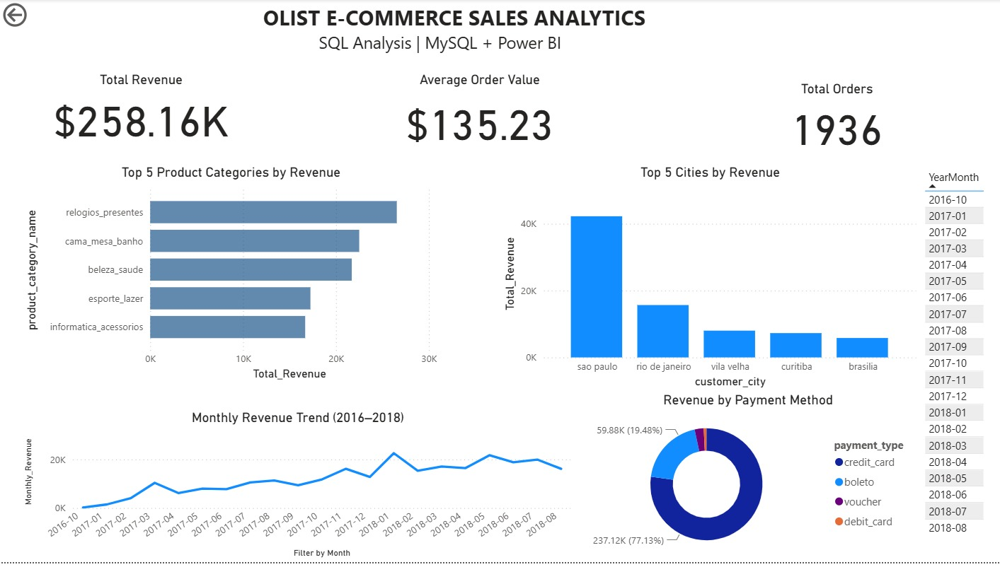

# Zepto SQL Data Analytics Project

## Project Overview

This project focuses on analyzing e-commerce data using SQL to uncover insights into sales performance, customer purchasing behavior, product category performance, and business trends.

Using MySQL, the project explores data cleaning, data validation, aggregation, joins, subqueries, Common Table Expressions (CTEs), and window functions to answer business questions and support data-driven decision-making.

The project demonstrates practical SQL skills through structured analysis and business-focused queries.

## Tools and Technologies

- MySQL
- MySQL Workbench
- SQL
- GitHub

## Project Objectives

- Analyze sales and revenue performance.
- Identify top-performing products and categories.
- Evaluate customer purchasing patterns.
- Analyze order and payment trends.
- Perform data quality checks.
- Generate actionable business insights using SQL.

## Tools and Technologies

| Tool | Purpose |
|---|---|
| MySQL | Data querying and analysis |
| MySQL Workbench | Database management and SQL development |
| SQL | Joins, aggregations, subqueries, CTEs, and window functions |
| Power BI | Dashboard design and data visualization |
| DAX | Measures and calculated metrics, where applicable |
| GitHub | Project documentation and version control |

## Dataset Description

The project uses a reduced sample of the public **Olist Brazilian E-Commerce dataset**. The sample was selected to support practical SQL analysis and dashboard development.

### Database Tables

| Table | Description |
|---|---|
| `customers` | Customer identifiers, cities, states, and location information |
| `orders` | Order status and purchase, approval, and delivery timestamps |
| `order_items` | Products purchased, seller identifiers, item prices, and freight values |
| `products` | Product categories and product attributes |
| `sellers` | Seller identifiers and location information |
| `payments` | Payment types, installments, and payment values |
| `reviews` | Customer review scores and review information |

## Database Schema

The Entity Relationship Diagram (ERD) illustrates the relationships between customers, orders, products, sellers, payments, and reviews.

<p align="center">
  
</p>

## Power BI Dashboard

The dashboard summarizes the main business metrics and provides visual comparisons across product categories, cities, payment methods, and months.

<p align="center">
  
</p>


### Dashboard Components

**1. Total Revenue**

Displays the total product revenue calculated from the selected sample.

**2. Average Order Value**

Shows the average revenue per order, based on the definition used in the analysis.

**3. Total Orders**

Displays the number of orders included in the dashboard's order-count measure.

**4. Top 5 Product Categories by Revenue**

Ranks product categories by revenue to identify the strongest contributors to sales.

**5. Top 5 Cities by Revenue**

Highlights the five customer cities contributing the highest revenue in the analyzed sample.

**6. Monthly Revenue Trend**

Shows how monthly revenue changes over time, helping identify stronger and weaker sales periods.

**7. Revenue by Payment Method**

Compares payment methods based on recorded payment value and illustrates their relative contribution.

**8. Month Filter**

Allows users to select a month and explore how the dashboard metrics change for the selected period.

## Key Performance Indicators

The current dashboard displays the following values:

| KPI | Dashboard Value |
|---|---:|
| Total Revenue | $258.16K |
| Average Order Value | $135.23 |
| Total Orders | 1,936 |

*Note: The source dataset is Brazilian, and the original monetary values are generally expressed in Brazilian reais (BRL). The currency symbol and formatting should be verified in Power BI before publishing. The figures represent the selected sample and may vary depending on filters and metric definitions.*

## Business Questions Answered

This project explores questions relevant to e-commerce business operations:

1. What is the total product revenue in the selected sample?
2. What is the average order value?
3. Which product categories generate the highest revenue?
4. Which customer cities contribute the most revenue?
5. Which payment methods account for the largest payment value?
6. How does revenue change from month to month?
7. Which customers have the highest spending?
8. How many orders fall into each order status?
9. What proportion of orders were cancelled?
10. What is the average delivery time?
11. How frequently do deliveries arrive later than estimated?
12. What patterns can be identified in customer review scores?

## SQL Analysis Performed

### 1. Data Validation

- Checked for duplicate order identifiers.
- Identified missing customer identifiers.
- Validated customer, product, and seller relationships.
- Checked for invalid item prices and payment values.
- Examined missing delivery timestamps.

### 2. Sales Analysis

- Calculated total product revenue.
- Calculated average order value.
- Compared revenue across product categories.
- Analyzed monthly revenue.
- Calculated month-over-month revenue changes.
- Ranked cities by revenue contribution.

### 3. Customer Analysis

- Identified high-spending customers.
- Examined repeat purchasing behavior.
- Compared customer spending with average spending.
- Used ranking functions to compare customer performance.

### 4. Product Analysis

- Ranked product categories by revenue.
- Identified top-performing products within categories.
- Compared revenue contributions across categories.

### 5. Payment Analysis

- Aggregated payment value by payment method.
- Compared payment method usage.
- Examined payment distribution across the sample.

### 6. Delivery and Order Analysis

- Analyzed order status.
- Calculated delivery time in days.
- Compared actual and estimated delivery dates.
- Examined cancellation rates.

### 7. Advanced SQL

The project demonstrates:

- Common Table Expressions (CTEs)
- Subqueries
- `INNER JOIN` and `LEFT JOIN`
- Aggregate functions such as `SUM`, `AVG`, and `COUNT`
- Conditional logic using `CASE`
- Ranking functions such as `RANK` and `DENSE_RANK`
- `LAG` for previous-period comparisons
- Window functions and cumulative calculations

## Key Findings

Based on the current sample analysis:

- **Product category performance:** `relogios_presentes` ranks first among the five displayed product categories by revenue.
- **Geographic contribution:** São Paulo ranks first among the five displayed customer cities by revenue.
- **Payment preferences:** Credit cards represent the largest share of the recorded payment value.
- **Revenue trend:** Monthly revenue varies over the analyzed period, with some months performing more strongly than others.
- **Data quality:** Several validation checks were performed to assess missing values, duplicate identifiers, and relationships between tables.

These findings are descriptive observations from the selected sample and should not be interpreted as results for the complete Olist business.

## Project Folder Structure

```text
olist-ecommerce-sales-analytics/
│
├── images/
│   ├── eer-diagram.png
│   └── sales-dashboard.png
│
├── 01_data_validation.sql
├── 02_sales_analysis.sql
├── 03_customer_analysis.sql
├── 04_product_analysis.sql
├── 05_payment_analysis.sql
├── 06_delivery_analysis.sql
├── 07_advanced_sql.sql
│
├── business_insights.md
└── README.md
```

## How to Run the Project

### Step 1: Set Up the Database

Install MySQL Server and MySQL Workbench, then create a database for the project.

### Step 2: Import the Dataset

Import the required CSV files into their corresponding tables. Verify that the column names and data types match the SQL scripts.

### Step 3: Run the SQL Scripts

Open the `.sql` files in MySQL Workbench and execute the queries against the imported dataset.

### Step 4: Review the Results

Check the output of the validation queries and analytical calculations. Ensure the dashboard metrics use consistent definitions.

### Step 5: Open the Power BI Dashboard

Open the Power BI report, configure the data connection if required, refresh the data, and explore the available visuals and month filter.

## Data Limitations

- The analysis uses a reduced sample rather than the full public dataset.
- Results may differ from analyses performed on the complete dataset.
- Revenue, average order value, and order counts depend on their SQL or DAX definitions.
- Payment totals and product revenue are different measures and should not be treated as interchangeable.
- Customer-city revenue reflects the location information recorded in the sample.
- The dashboard should be refreshed and validated if the source data or metric definitions change.

## Future Improvements

- Add delivery performance KPI cards.
- Include order status distribution with multiple statuses.
- Add a customer repeat-purchase analysis visual.
- Create a dedicated cancellation and delivery performance page.
- Improve currency formatting and tooltip descriptions.
- Add a data dictionary and documented SQL metric definitions.
- Expand the analysis using the complete dataset.

## Skills Demonstrated

**SQL | MySQL | Data Cleaning | Data Validation | Exploratory Data Analysis | Business Intelligence | Power BI | KPI Development | Data Visualization | Business Insights | GitHub**

## Project Note

This is a portfolio project developed for learning and demonstrating SQL analysis and business intelligence skills. The findings are based on a selected sample of the public Olist Brazilian E-Commerce dataset.

